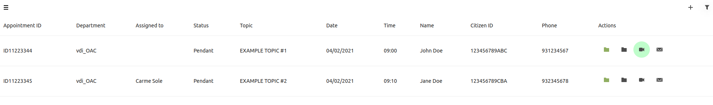
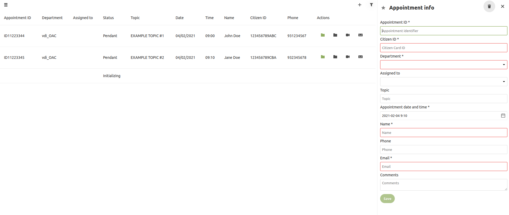
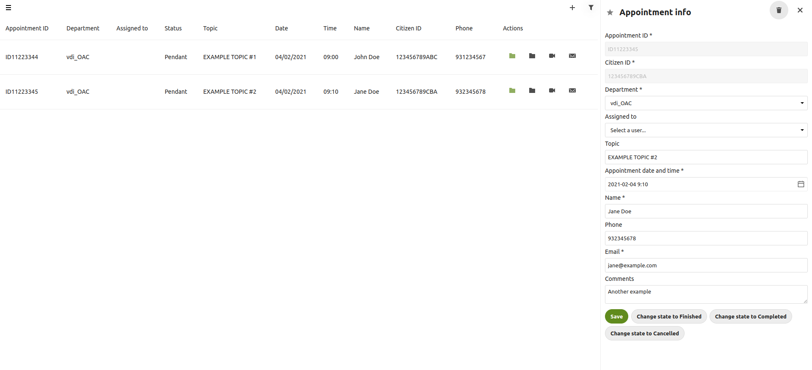

# VTramit

Nextcloud App for administrative proceedings with public administrations through Videoconferences


VTramit is a [Nextcloud](https://nextcloud.com) App for handling appointments with videoconferences on [Jitsi](https://jitsi.org).

This APP has been released under AGPL v3 license, made by mutual agreement between [FLOSS](https://floss.cat) and [Barcelona City Council](https://ajuntament.barcelona.cat), under the project "Atenció per Videotrucada a la Ciutadania", following the principles of Agile Development and [Public Money, Public Code](https://publiccode.eu) initiative, adhering to the principles of the [Ethical Digital Standards](https://citiesfordigitalrights.org) of Barcelona City Council.

In 2021 [Videoatención](https://videoatencion.com) was founded to maintain further development and to provide deployment services for VTramit.

At the present moment it is being used by different departments of the municipality to allow citizens to bring support and carry out administrative procedures through video calls, and several other municipalities that have joined the project in order to contribute to its development and bring the service to their citizens.

This project has a strong focus on privacy, security and compliance with the current legal framework. It keeps track of any event on Activity log, handles RGPD authorizations and integrates with digital signatures where necessary.


Feel free to contact us at [Videoatencion.com](https://videoatencion.com) if you need further assistance.

**Example of a Citizen waiting to be attended:**



**Add a new appointment:**



**Edit an appointment:**



This is an ongoing project, check the [TODO](docs/TODO.md) list and the [ROADMAP](docs/ROADMAP.md) and feel free to send us your feature requests here on GitHub.

In order to ease testing and for security reasons, we're only going to support up to date versions of Nextcloud. Please, upgrade regularly!

## INSTALL

For detailed installation see [INSTALL](docs/INSTALL.md).

### Production install (release tarball)

Releases are published as tarballs on this repository's [Releases](../../-/releases) page. The CI pipeline builds, packages, and uploads them automatically on every `vX.Y.Z` tag.

```sh
GL=https://gitlab.gitlab.videoatencion.com
PROJECT=videoatencion/vtramit/vtramit-app
TOKEN=glpat-...   # only for private repos; or export VTRAMIT_TOKEN, or write to /etc/vtramit/gitlab-token

# 1. Resolve the latest tag via the API (works with PRIVATE-TOKEN auth)
TAG=$(curl -fsSL -H "PRIVATE-TOKEN: $TOKEN" \
        "$GL/api/v4/projects/${PROJECT//\//%2F}/releases?per_page=1" \
      | grep -o '"tag_name":"[^"]*"' | head -1 | sed 's/.*:"\([^"]*\)".*/\1/')

# 2. Download and extract into apps/
cd /var/www/nextcloud/apps
curl -fL -H "PRIVATE-TOKEN: $TOKEN" \
  "$GL/$PROJECT/-/releases/$TAG/downloads/binaries/vtramit.tar.gz" \
  | sudo tar xz
sudo chown -R www-data:www-data vtramit

# 3. Enable the app in Nextcloud
sudo -u www-data php /var/www/nextcloud/occ app:enable vtramit

# 4. (Optional) symlink the upgrade script for convenience
sudo ln -s /var/www/nextcloud/apps/vtramit/vtramit-update /usr/local/sbin/vtramit-update
```

> Note: GitLab's `/-/releases/permalink/latest/...` URL works in the browser (where you're logged in) but **doesn't** accept `PRIVATE-TOKEN` for unattended downloads, so the API lookup above is the canonical "latest" pattern. After the first install, `vtramit-update` does this resolution for you automatically.

### Upgrade

```sh
sudo /var/www/nextcloud/apps/vtramit/vtramit-update           # latest release
sudo /var/www/nextcloud/apps/vtramit/vtramit-update v2.5.0    # specific version
sudo /var/www/nextcloud/apps/vtramit/vtramit-update --check   # dry run, show changes
```

The upgrade script:
- Downloads the tarball from the GitLab Release
- Computes the diff vs. the installed `MANIFEST.txt`
- Backs up the current install to `/var/backups/vtramit/`
- Enters Nextcloud maintenance mode
- Removes files no longer present upstream (respecting `.upgrade-keep`)
- Syncs new files in (without overwriting anything listed in `.upgrade-keep`)
- Runs `occ upgrade`
- Exits maintenance mode

### Customising files per tenant (`.upgrade-keep`)

Some files are commonly customised per tenant (e.g. `templates/publicPortal-headers.php` for CSP policies, branding images). To prevent the upgrade script from overwriting them, list their paths in `/var/www/nextcloud/apps/vtramit/.upgrade-keep` (rsync-style patterns). The file ships with sensible defaults; the file itself is preserved across upgrades.

### Rollback

Every upgrade leaves a timestamped backup at `/var/backups/vtramit/`. To roll back:

```sh
sudo -u www-data php /var/www/nextcloud/occ maintenance:mode --on
sudo rm -rf /var/www/nextcloud/apps/vtramit
sudo tar xzf /var/backups/vtramit/vtramit-<old-version>-<timestamp>.tar.gz -C /var/www/nextcloud/apps/
sudo -u www-data php /var/www/nextcloud/occ maintenance:mode --off
```

If the upgrade ran DB migrations, restore your DB dump as well.


## CONTRIBUTORS

<table>
<tr><td align="center"><a href="https://ajuntament.barcelona.cat" target="_blank"><br/><strong>Ajuntament de Barcelona</strong></a></td>
<td>Original idea, project definition and funding. Legal, Privacy and Security advise.</td></tr>
<tr><td align="center"><a href="https://floss.cat" target="_blank"><br/><strong>FLOSS</strong></a></td>
<td>Architecture, requirements analysys and programming. Translation into Galician, Portuguese and Italian.</td></tr>
<tr><td align="center"><a href="https://rubi.cat" target="_blank"><br/><strong>Ajuntament de Rubí</strong></a></td>
<td>Beta testing new features. Integration with 3rd party booking solutions.</td></tr>
<tr><td align="center"><a href="https://www.pamplona.es" target="_blank"><br/><strong>Ayuntamiento de Pamplona</strong></a></td>
<td>Cleaning up code. Translation to Basque.</td></tr>
<tr><td align="center"><a href="https://granollers.cat" target="_blank"><br/><strong>Ajuntament de Granollers</strong></td>
<td>Testing under an extense number of use cases. Contributions to project Roadmap.</td></tr>
<tr><td align="center"><a href="https://santcugat.cat" target="_blank"><br/><strong>Ajuntament de Sant Cugat</strong></td>
<td>Contibutions to project Roadmap. Betatesting of GA release.</td></tr>
</table>

